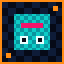
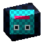

# Pribambase 2.4 — руководство пользователя

Pribambase связывает один Blender-ассет с исходной покадровой текстурой Aseprite. Художник
рисует в Aseprite и видит результат на модели, а Blender отправляет обратно безопасный render
guide для каждого кадра.




## Главная идея

У каждой части ассета есть свой источник истины:

| Данные | Где редактируются |
|---|---|
| Геометрия, деформации и покадровая анимация | Blender |
| Свет и World | Blender |
| Base Color, AO, Roughness, Metallic и Emission | Aseprite |
| Упакованная ORME-карта | Автоматически собирается extension |
| World Normal source 2× | Инициализируется из геометрии и редактируется по модели в Blender |
| World Normal output | Усредняется из source блоками 2×2 и приходит в Aseprite только для чтения |
| Render guide | Генерируется Blender |
| Связь исходников и параметры проекции | `*.pribambase.json` |

Плагин не создаёт отдельную UV-развёртку для каждого кадра. Все модели используют одну
зафиксированную world-space проекцию и один общий canvas на всю анимацию.

## Установка

### Blender add-on

1. Откройте **Edit → Preferences → Add-ons**.
2. Установите архив Blender add-on и включите его.
3. В 3D Viewport откройте `N → Tool → Pribambase`.

При разработке из этого репозитория используйте PyCharm-конфигурацию
**Blender - Run add-on**. Настройка среды описана в [DEVELOPMENT.md](../DEVELOPMENT.md).

### Aseprite extension

Соберите и установите dev-версию:

```powershell
.\aseprite.ps1 install
```

Либо соберите пакет командой `.\aseprite.ps1 build` и установите
`dist/pribambase.aseprite-extension` через Aseprite. После перезапуска в меню **File** появится
команда **Pribambase: Start Sync**.

Версии Blender add-on и Aseprite extension должны совпадать.

## Быстрый старт на сэмпле

```powershell
.\sample.ps1 run
```

После запуска:

1. В Blender откройте `N → Tool → Pribambase` и нажмите **Start Sync**.
2. В Aseprite выберите **File → Pribambase: Start Sync**.
3. Дождитесь статуса `Sync active`.
4. Откройте **File → Pribambase: Material Channels**, выберите канал и измените пиксели — материал куба обновится.
5. Измените геометрию или свет в Blender — в Aseprite обновится reference-слой
   `Pribambase Render`.
6. В Blender инициализируйте **World Normal Edit**, поправьте направления и нажмите
   **Rebuild + Send**. Результат появится на вкладке **Generated** в Aseprite.

Если Blender перезапускается или соединение временно пропадает, останавливать Sync в Aseprite не
нужно: окно остаётся активным и каждые две секунды создаёт новое соединение. Кнопка **Reconnect Now**
запускает попытку немедленно; только **Stop** полностью прекращает автоматические повторы.

Сэмпл специально не содержит UV-layer: текстура приходит на объект через глобальную проекцию.

## Глобальная проекция

Профиль `global_iso_v1` одинаков во всех Blender-файлах:

- `20` пикселей на одну Blender unit;
- горизонталь текстуры совпадает с глобальной осью X;
- вертикаль текстуры вычисляется из глобальных Y/Z под фиксированным углом 30°;
- глобальная точка `(0, 0, 0)` является постоянной опорной точкой ассета;
- положение обычной камеры сцены не влияет ни на материал, ни на guide.

Практически это означает: ставьте точку касания модели с землёй в мировой ноль. Один и тот же
пиксель текстуры будет соответствовать одному и тому же месту глобальной проекции на каждом кадре.

### Общий canvas анимации

Кнопка **Recalculate Canvas** просматривает каждый кадр от `Frame Start` до `Frame End`, вычисляет
проекцию всех вершин в **Projected Collection** и берёт объединение максимальных bounds. В canvas
также всегда входят мировой ноль и заданный **Canvas Padding**.

Canvas один для всех кадров. Он не меняет размер и offset при переходе между кадрами, поэтому
рисунок в Aseprite не прыгает относительно модели.

Если более поздняя деформация выходит за старые bounds, включённый **Auto-grow** расширяет canvas:

- Blender сдвигает существующие пиксели без фильтрации;
- Aseprite добавляет прозрачное место с нужных сторон;
- все кадры и слои сохраняют положение относительно мировой нулевой точки;
- автоматического уменьшения и обрезки не происходит.

Расширение canvas в Aseprite попадает в undo history, но `.aseprite` не сохраняется автоматически.

### Камера

Guide всегда рендерится временной канонической камерой. После рендера Pribambase возвращает
пользовательскую камеру, её transform и render settings в исходное состояние. Для guide временно
используется минимальный pixel filter: Blender не создаёт полупрозрачные сглаженные края, и каждому
выходному пикселю соответствует ровно один пиксель canvas. Число render samples не меняется, поэтому
мягкие тени, AO и освещение сохраняют заданное в сцене качество.

**Restore Camera** намеренно ставит активную камеру в канонический ракурс и выставляет точное
разрешение общего canvas. Это команда для проверки кадрирования; проекция материала от камеры не
зависит. Художник может свободно двигать тестовые камеры и проверять модель при другом освещении.

**View Camera** не меняет transform или настройки камеры: кнопка только переводит текущий 3D
Viewport в вид через активную render camera, как `Numpad 0`. Обычно сначала используют
**Restore Camera**, а затем **View Camera**, чтобы сразу увидеть точное кадрирование guide.

## Настройка нового Blender-ассета

1. Сохраните `.blend`.
2. Поместите все проецируемые mesh-объекты в отдельную коллекцию, например `Character`.
3. Создайте или загрузите в Blender изображение с текущим размером Aseprite sprite. PNG-копия
   подходит как стартовый fallback.
4. В **Source Pair** задайте **Asset** и путь **Aseprite**.
5. В **Global Projection** выберите **Projected Collection** и **Paint Texture**.
6. Нажмите **Recalculate Canvas**.
7. Нажмите **Create / Repair Material**.
8. При необходимости нажмите **Restore Camera**.
9. Нажмите **Save Pair**, затем **Start Sync**.

**Create / Repair Material** создаёт один материал `PB_<Asset>_Projected`, назначает его всем
mesh-объектам выбранной коллекции и подключает Paint Texture и Material ORME с фильтрацией
`Closest`. Существующие UV-развёртки не используются.

## Материал между проектами

Каждый source pair имеет локальную оболочку материала, потому что изображение и размеры canvas у
ассетов разные. Внутри неё используется одинаковая версионированная группа
`PB_MasterShader_v4`, которую add-on создаёт из одного определения во всех `.blend`.

Master-группа принимает Base Color, Ambient Occlusion, Roughness, Metallic, Emission Mask и
Emission Strength. Opacity намеренно не входит в контракт. Scalar-каналы хранятся в одном
`PB_<Asset>_ORME` image: `R=AO`, `G=Roughness`, `B=Metallic`, `A=Emission`. В Blender карта имеет
color space **Non-Color** и автоматически раскладывается по входам master-группы.

Base Color, Roughness и Metallic поступают в Principled BSDF напрямую. AO не умножается на
Base Color: в основном EEVEE-preview сначала рассчитывается PBR-освещение, после чего AO
ослабляет только освещённую составляющую пропорционально её яркости. Поэтому AO сильнее заметен
на участках с окружающим светом и почти не добавляет темноты в уже тёмных местах. Для металлов
учитывается Roughness: гладкие отражения сохраняются, а матовые сильнее получают occlusion.
Emission не зависит от AO и складывается после него как
`Base Color × Emission Mask × Emission Strength`.

Blender 5.2 не предоставляет material AO-вход для metallic Principled BSDF. Поэтому Cycles-ветка
использует чистый Principled без нарисованного AO и получает естественное затенение от геометрии/GI.
При экспорте в игровой PBR-материал `ORME.R` должен подключаться как отдельная occlusion texture,
а не запекаться в Base Color.

World Normal является отдельной RGB-картой в глобальных координатах, а не частью ORME. Вектор
`(-1…1)` кодируется как RGB `(0…1)`: красный — глобальная X, зелёный — глобальная Y, синий —
глобальная Z. Источник истины — редактируемая World Normal source 2× внутри `.blend`. Output подключается через
Blender **Normal Map / World Space**, а её применение можно независимо выключить галочкой
**Apply Generated World Normal**.

Live-link внешней material-library пока нет. Версионированная master-группа — основа для такого
подключения без изменения source pair и глобальной проекции.

## Source pair и манифест

Рекомендуемая структура:

```text
goblin/
├── goblin.blend
├── goblin_texture.aseprite
└── goblin.pribambase.json
```

Манифест версии 3 хранит:

- относительные пути `.blend` и `.aseprite`;
- FPS и диапазон кадров;
- настройки live updates;
- профиль проекции и pixels-per-unit;
- имена коллекции, изображения и материала;
- bounds, размер canvas и позицию мирового нуля в пикселях.
- параметры World Normal Edit: тип source, масштаб 2×, применение normal map и автообновление.

**Save Pair** пишет манифест рядом с `.blend`. **Load Pair** восстанавливает настройки по именам
databлоков. Храните все три файла вместе в Git; для `.blend` и `.aseprite` обычно удобен Git LFS.

## Работа в Aseprite

Панель **Pribambase Channels** автоматически открывается вместе с **Start Sync** и не блокирует
рисование. Её можно переместить рядом с настройками кисти; позиция, активная вкладка и
последний канал запоминаются. Если панель закрыта, верните её через
**File → Pribambase: Material Channels**.

Для старого sprite один раз откройте вкладку **Actions** и нажмите **Initialize / Migrate**.
Extension создаст типизированную структуру и безопасно перенесёт существующие paint-слои в
**Base Color**:

```text
Pribambase
├── Base Color
├── Material Channels
│   ├── Ambient Occlusion
│   ├── Roughness
│   ├── Metallic
│   └── Emission
```

Служебные `Pribambase Render` и `Pribambase World Normal` находятся отдельно как заблокированные
reference-слои. Они принадлежат Blender и не входят в структуру редактируемых каналов.

Выберите канал в поле **Channel**. Для AO, Roughness, Metallic и Emission редактор:

- показывает одно grayscale-значение `0…255` и его нормализованный эквивалент `0…1`;
- предлагает понятные presets, например Non-metal/Metal и Polished/Matte/Rough;
- переключает видимость так, чтобы на canvas был только редактируемый канал;
- оставляет Base Color видимым под каналом и показывает канал полупрозрачным overlay;
- выбирает отдельный Paint layer; кнопка **Add Paint Layer** создаёт ещё один;
- после каждого изменения автоматически собирает ORME и отправляет её в Blender.

Панель разделена на четыре компактные вкладки:

- **Paint** — Brush Value, presets и Add Paint Layer;
- **View** — видимость и opacity Base Color, отправка каналов и overlay;
- **Generated** — видимость Render Guide и World Normal, статус текущего кадра и запрос rebuild;
- **Actions** — инициализация/миграция, принудительный refresh и просмотр packed ORME.

При инициализации первый **Paint** cel каждого канала один раз целиком заполняется значением по
умолчанию: AO `255`, Roughness `128`, Metallic `0`, Emission `0`. Отдельных Default layers нет,
а основная карта канала не зависит от прозрачности. При добавлении кадров extension создаёт для
них такой же заполненный cel; при увеличении canvas заполняет дефолтом новые области.

По умолчанию служебные channel-layers имеют **Overlay Opacity 38%**, поэтому форма и цвет основной текстуры
остаются видны во время рисования. Настройка регулируется в Channel Editor и хранится отдельно для
каждого канала. Это только preview-настройка Aseprite: она не ослабляет значения, которые попадают
в ORME. Для значений рисуйте нужным grayscale-цветом; layer opacity у channel-layers
зарезервирован под preview. Дополнительные Paint layers остаются необязательными overlay-слоями,
но под ними всегда находится непрозрачный основной Paint.

Render Guide всегда перемещается в самый низ стека, чтобы все paint-слои отображались поверх него.
**Base Opacity** временно делает Base Color полупрозрачным для рисования по guide. Это preview-настройка:
в Blender продолжает отправляться исходная непрозрачность paint-слоёв. **Reset Base Opacity** возвращает
их отображение к исходным значениям.

Галочки **Send to Blender** независимо управляют Base Color, AO, Roughness, Metallic и Emission.
Они не скрывают и не изменяют paint-слои: выключенный канал только заменяется дефолтом в сообщении
для Blender. Используются серый Base Color `204`, AO `255`, Roughness `128`, Metallic `0` и
Emission `0`. Изменение галочки сразу обновляет Blender, поэтому результат можно проверять по
Render Guide прямо в Aseprite.

**Show Packed ORME** открывает временный диагностический sprite. Его не редактируют и не сохраняют
как источник. **Refresh Blender** принудительно пересобирает текущий кадр, если автоматическое
обновление не было видно.

Extension распознаёт служебные группы по внутренним properties, поэтому художник может их
переименовывать. Не копируйте отдельные группы между независимыми `.aseprite`: для нового файла
используйте **Initialize Channels**.

Blender guide создаётся как заблокированный reference-слой вне Base Color и не входит в composite,
который extension отправляет обратно. Поэтому guide и скрытые material-каналы не могут случайно
«запечься» в Base Color.

World Normal устроен так же: это заблокированный reference-слой с отдельным cel для каждого кадра.
Его можно показывать на вкладке **Generated**, но нельзя рисовать или стирать в Aseprite. Повторный
bake заменяет байты существующего cel без добавления обычного действия рисования в undo history.
**Request Rebuild** просит Blender пересобрать текущий кадр; sync должен быть активен.

Если обычный слой уже называется `Pribambase Render`, extension создаст reference-слой с
суффиксом `(Guide)` и не затронет пользовательские пиксели.

## Покадровая анимация

Кадры сопоставляются один к одному:

```text
Blender frame 1  ↔  Aseprite frame 1
Blender frame 2  ↔  Aseprite frame 2
```

При включённом **Follow Animation Frame** приложения повторяют переключение кадра. Если Blender
отправляет guide на ещё не существующий кадр Aseprite, extension сначала добавляет пустые кадры,
затем создаёт reference-cel. Paint-cels не удаляются.

Если у Base Color или material-канала нет собственного cel на текущем кадре, при отправке в Blender
используется последний предыдущий cel. Это работает как hold exposure: создание новых guide-кадров
не превращает материал модели в чёрный. Чтобы намеренно очистить канал на кадре, создайте на нём
собственный прозрачный cel.

Для 12 FPS без интерполяции выберите ключи Blender и задайте
**Key → Interpolation Mode → Constant**. Допустимы rig, shape keys, lattice, modifiers и ручная
покадровая деформация — canvas считается по итоговой evaluated mesh каждого кадра.

После изменения диапазона кадров или крупной деформации нажмите **Recalculate Canvas** перед
пакетным обновлением guides.

## Прямое редактирование World Normal

Блок **World Normal Edit** хранит для каждого кадра отдельную редактируемую world-space normal map
с удвоенным разрешением. Например, canvas `64×64` получает source `128×128`. Итоговый пиксель
вычисляется из принадлежащих ему четырёх samples 2×2: Blender усредняет векторы с учётом alpha и
повторно нормализует результат. Output остаётся `64×64` и подходит к остальным игровым текстурам.

Базовый процесс:

1. Рассчитайте общий animation canvas.
2. На нужном кадре нажмите **Initialize from Geometry**. Blender запечёт видимые геометрические
   нормали в editable source 2× и неизменяемый **Geometry Normal** 1×, сохранив резкие переходы
   между гранями.
3. Выберите направление **World Normal**, режим Brush, Radius и Strength.
4. Нажмите **Paint Normals** и рисуйте левой кнопкой по mesh. `Q/E` циклически переключают кисти,
   `1–5` напрямую выбирают Paint/Set/Smooth/Bulge/Dent. `Ctrl+колёсико` меняет запоминаемый радиус активного
   инструмента, `Alt+колёсико` меняет Strength с шагом 5%, `Shift` временно включает Smooth, `Alt`
   с ЛКМ берёт направление из видимого normal preview, `MMB` перемещает viewport в плоскости камеры,
   а обычное колёсико меняет масштаб Camera View. `Tab`/`Shift+Tab` переключают preview вперёд/назад,
   а `Shift+1–4` напрямую выбирают Edited/Final/Geometry/Material. `Ctrl+Z` отменяет отдельный мазок,
   `Ctrl+Shift+Z` или `Ctrl+Y` возвращает его. `Enter`, `Esc` и правая кнопка завершают режим и
   сохраняют текущий результат в `.blend`.
5. При включённом **Auto Rebuild** output сразу пересобирается. Иначе нажмите **Rebuild + Send**.

Доступные операции:

- **Paint Direction** — плавно приближает нормали к выбранному world-space направлению;
- **Set Pixel** — записывает выбранное направление точно, без strength и falloff;
- **Smooth** — усредняет соседние направления; используйте осознанно возле жёстких границ;
- **Bulge** — радиально наклоняет нормали наружу и создаёт выпуклость без height map;
- **Dent** — наклоняет их к центру и создаёт впадину. Paint, Smooth, Bulge и Dent хранят свои
  радиусы независимо, поэтому переключение инструмента не сбрасывает привычный размер.

Вектор **World Normal** задаётся компонентами X/Y/Z и нормализуется перед записью. Пипетка рядом с
полем или `Alt+ЛКМ` копирует направление из текущего normal preview: из **Edited** берётся ручная
карта 2×, из **Geometry** — исходная геометрическая normal map, из **Final** — итоговый пиксель после
усреднения и нормализации 2×2. Для **Set Pixel**:

- **Output Pixel (2×2)** заменяет все четыре edit samples одного итогового пикселя;
- **Edit Sample (1×1)** заменяет один sample source 2× и позволяет вручную задать вклад в
  последующее усреднение.

У Set есть отдельный **Size**, меняемый `Ctrl+колёсиком`. Размер `1` сохраняет точечную запись.
Большие значения заполняют точный квадрат без falloff: в режиме Output Pixel размер считается в
итоговых пикселях и раскрывается в блоки 2×2, а в Edit Sample — непосредственно в samples source 2×.
При уменьшении ниже Output Size 1 кисть автоматически переходит на минимальную ступень Edit Sample
1×1. При увеличении выполняется обратный переход: Edit 1×1 → Output 1 → Output 2.

### Свободный Normal Ball

Кнопка с гизмо рядом с пипеткой или клавиша `N` внутри Paint Normals открывает Normal Ball около
курсора. Центр направлен к канонической projection camera, края соответствуют касательным
направлениям. Цвет шара — реальный encoded World Normal RGB. Красные +X/-X, зелёная -Y и синяя +Z
оси показывают доступные глобальные направления передней полусферы; выбранное направление
отображается стрелкой на шаре и над точкой модели. Более
прозрачная стрелка на модели показывает текущее направление пикселя для сравнения.

- **Continuous** разрешает любое единичное направление передней полусферы.
- **Quantized** округляет направление по углу, а не по RGB-каналам.
- **Arc Divisions N** делит каждую дугу в 90° между соседними глобальными направлениями на `N`
  равных углов: `1/2 = 45°`, `1/3 = 30°`, `1/4 = 22,5°` (по умолчанию), вплоть до
  `1/12 = 7,5°`.

Палитра строится на гранях глобального октаэдра `±X/±Y/±Z`. На его рёбрах точки являются точными
долями дуги большого круга. Направления внутри каждой тройки осей вычисляются симметрично сразу по
`X/Y/Z`, без последовательных Euler-поворотов, поэтому результат не зависит от порядка вращений.
При `N=2` доступны все видимые сочетания соседних глобальных осей под 45°.

Внутри пикера `Q` переключает Continuous/Quantized, колёсико меняет `N`, а `Ctrl`
временно привязывает направление к видимой глобальной оси. ЛКМ/Enter подтверждают; ПКМ/Esc закрывают
только Normal Ball и возвращают в Paint Normals без завершения сеанса. Рядом с шаром показываются
точные XYZ и RGB выбранной нормали.

Кнопки **Material / Edited / Geometry / Final** переключают обычный освещённый материал, editable
source 2×, исходную геометрическую карту 1× и финальную World Normal 1× как unlit encoded RGB.
**Final** показывает именно изображение, подключённое к World Normal node материала и отправляемое в
Aseprite. Paint Normals автоматически открывает Edited; `Tab` и `Shift+Tab` циклически переключают
режимы в обе стороны, а `Shift+1–4` выбирают их напрямую. При начале мазка поверх Geometry или Final
плагин возвращает Edited, чтобы результат сразу был виден. При Auto Rebuild обычный материал
обновляется после отпускания ЛКМ. Предпросмотр виден в режимах viewport **Material Preview** и
**Rendered**. Render Guide для Aseprite всегда временно использует Material, поэтому debug-карта в
guide не попадёт.

Source создаётся отдельно для каждого кадра, без hold: деформированная геометрия получает свои
границы и исходные направления. **Reset from Geometry** заново запекает текущий кадр и удаляет его
ручные правки; **Remove Frame** удаляет source и output этого кадра. Если после инициализации
изменилась геометрия, панель показывает предупреждение — сбрасывать source необязательно, но новые
силуэты и грани появятся только после Reset from Geometry.

Галочка **Apply Generated World Normal** влияет только на Blender shader и render guide: она не
удаляет editable source или output. В Aseprite приходит только итоговая base-resolution карта как
read-only reference-layer.

## Команды Blender

### Global Projection

| Команда или настройка | Назначение |
|---|---|
| **Projected Collection** | Mesh-объекты, участвующие в bounds и общем материале |
| **Paint Texture** | Blender Image, обновляемый из Aseprite |
| **Material ORME** | Сгенерированная карта AO/Roughness/Metallic/Emission |
| **Emission Strength** | Яркость свечения там, где Emission больше нуля |
| **Canvas Padding** | Прозрачный запас вокруг максимальных bounds |
| **Auto-grow** | Расширять общий canvas при росте анимации |
| **Recalculate Canvas** | Просканировать весь диапазон кадров |
| **Restore Camera** | Вернуть канонический ракурс и разрешение |
| **View Camera** | Перевести текущий 3D Viewport в вид через активную render camera |
| **Create / Repair Material** | Пересоздать и назначить world-projected материал |

### World Normal Edit

| Команда или настройка | Назначение |
|---|---|
| **Initialize / Reset from Geometry** | Запечь source 2× и неизменяемый Geometry Normal 1× текущего кадра |
| **Remove Frame** | Удалить editable source, geometry reference и output текущего кадра |
| **World Normal** | Задать целевое направление X/Y/Z |
| **Brush / Radius / Strength** | Настроить direct-normal кисть |
| **Q/E или 1–5** | Переключить кисть во время Paint Normals |
| **Bulge / Dent** | Нарисовать выпуклость или впадину напрямую в world-space нормалях |
| **Ctrl+колёсико** | Изменить отдельный Radius/Size активного инструмента во время рисования |
| **Alt+колёсико** | Изменить Strength Paint, Smooth, Bulge или Dent с шагом 5% |
| **MMB / колёсико** | Сдвинуть viewport в плоскости камеры / изменить масштаб Camera View |
| **Ctrl+Z / Ctrl+Shift+Z / Ctrl+Y** | Отменить или вернуть отдельный мазок текущего сеанса |
| **Enter / Esc / ПКМ** | Завершить Paint Normals с сохранением текущего результата |
| **Paint Normals** | Начать рисование направлений непосредственно по модели |
| **Set Pixel / Size / Pixel Size** | Точно заполнить квадрат output pixels 2×2 или edit samples; Size меняется Ctrl+колёсиком |
| **Eyedropper / Alt+ЛКМ** | Взять направление из видимого Edited, Geometry или Final preview |
| **Normal Ball / N** | Свободно выбрать world normal или использовать углово-квантизированную палитру |
| **Material / Edited / Geometry / Final** | Сравнить материал, source 2×, geometry bake 1× и итоговую карту 1× |
| **Tab / Shift+Tab** | Переключить preview вперёд или назад |
| **Shift+1–4** | Напрямую выбрать Edited, Final, Geometry или Material |
| **Apply Generated World Normal** | Включить или выключить normal map в Blender shader |
| **Auto Rebuild** | Пересобирать World Normal после завершения кисти |
| **Auto Send to Aseprite** | Отправлять готовый output в read-only reference-слой |
| **Rebuild + Send** | Пересобрать и отправить текущий кадр вручную |
| **Rebuild Dirty Frames** | Пересобрать все устаревшие кадры |

### Live Updates

| Команда или настройка | Назначение |
|---|---|
| **Auto-render Current Frame** | Обновлять guide после изменения mesh, света или World |
| **Auto-render Delay** | Задержка перед автоматическим рендером |
| **Render Dirty Frames on Save** | Обновить изменённые кадры при сохранении `.blend` |
| **Follow Animation Frame** | Синхронизировать активный кадр |
| **Projection Layer** | Имя reference-слоя |
| **Update Guide** | Немедленно отрендерить текущий кадр |
| **Render Dirty Frames** | Последовательно отрендерить изменённые кадры |
| **Open Aseprite** | Открыть или сфокусировать парный sprite |
| **Pause** | Остановить обмен |

## Работа двух специалистов

Моделлер владеет основным `.blend`, меняет геометрию, деформации и эталонный свет, пересчитывает
canvas и публикует guides. Художник владеет `.aseprite`, рисует на paint-слоях и проверяет
результат на модели.

Для тестов в другом освещении полезен отдельный preview `.blend`, который подключает модель через
Blender Library Link или Library Override и использует тот же `.aseprite`. Так художник может
менять локальные лампы и камеры, не создавая конфликтов в основном бинарном файле.

## Работа по сети

По умолчанию Blender принимает соединения только с `localhost`. Для доверенной LAN:

1. Отключите **Same computer only** до запуска sync.
2. В Aseprite **Sync: Settings** укажите IP компьютера с Blender.
3. Проверьте одинаковый порт, по умолчанию `34613`.
4. Разрешите Blender во входящем firewall.

Протокол не содержит аутентификации и шифрования. Не публикуйте порт напрямую в интернет;
используйте доверенную сеть или VPN.

## Безопасность данных

- paint-слои и paint-cels не удаляются;
- guide использует только reference-layer;
- World Normal output использует read-only reference-layer, а editable source 2× остаётся в `.blend`;
- canvas автоматически только растёт и никогда не обрезается;
- входящая текстура не запускает бесконечный цикл обратных рендеров;
- временные PNG удаляются;
- пользовательская камера и render settings восстанавливаются после guide;
- `.aseprite` не сохраняется автоматически;
- **Save Pair** пишет JSON, но не заменяет сохранение `.blend`.

## Решение проблем

### Aseprite потерял соединение с Blender

- Оставьте окно Sync открытым: статус `Disconnected · retrying automatically...` означает, что
  повторные подключения уже выполняются каждые две секунды.
- После запуска Blender соединение восстановится без Stop/Start Sync.
- Для немедленной попытки нажмите **Reconnect Now** в основном окне или меню Actions.
- **Stop** используйте только когда хотите действительно завершить сессию синхронизации.

### Текстура не видна на модели

- Проверьте **Paint Texture**.
- Нажмите **Create / Repair Material**.
- Проверьте, что объект находится в **Projected Collection**.
- Используйте Material Preview или Rendered View.
- Проверьте статус `Sync active` и Aseprite **Size Limit**.

### Material-канал не меняется в Blender

- Откройте **Pribambase: Material Channels** и убедитесь, что выбран нужный канал.
- Рисуйте оттенками серого на Paint layer, созданном Channel Editor.
- Нажмите **Refresh Blender**.
- В Blender проверьте **Material ORME** и нажмите **Create / Repair Material**.
- Для Emission проверьте ненулевой **Emission Strength** и используйте Rendered/Material Preview.

### World Normal не видна или не обновляется

- Сначала нажмите **Recalculate Canvas**, затем **Initialize from Geometry** в World Normal Edit.
- Завершите Paint Normals клавишей `Enter` или нажмите **Rebuild + Send**.
- Убедитесь, что **Apply Generated World Normal** включена. Галочка доступна после первого bake.
- Проверьте целевое направление World Normal и Strength кисти.
- В Aseprite откройте вкладку **Generated** и включите **World Normal → Show**.
- Если output устарел на нескольких кадрах, нажмите **Rebuild Dirty Frames**.
- Для **Request Rebuild** должно быть активно соединение с Blender.

### Проекция смещена или обрезана

- Убедитесь, что опорная точка ассета находится около глобального `(0, 0, 0)`.
- Нажмите **Recalculate Canvas** после изменения геометрии или диапазона кадров.
- Нажмите **Restore Camera** для визуальной проверки.
- Не редактируйте значения canvas вручную в манифесте.

### Guide не появляется

- Убедитесь, что парный `.aseprite` открыт.
- Нажмите **Update Guide** и прочитайте сообщение Blender.
- Ищите reference-слой `Pribambase Render (Guide)`, если имя занято paint-слоем.
- Проверьте, что **Projected Collection** содержит renderable mesh.

### Guide выглядит размытым

- Обновите Blender add-on и Aseprite extension, затем снова нажмите **Update Guide**.
- Для guide Pribambase сам отключает render-side сглаживание; менять общие настройки рендера не нужно.
- Если размывается paint-текстура на модели, нажмите **Create / Repair Material**: её Image Texture
  должна использовать `Closest`.

### Area Light даёт пятнистый свет или шумные мягкие тени

В EEVEE большой Area Light рассчитывает мягкие тени случайными выборками. При малом числе лучей
частично перекрытый источник может выглядеть как пятна слабого света, особенно на небольшом
pixel-art guide. Это не шум Base Color или AO.

- Для заполняющего света (**Fill Light**) рекомендуется выключить **Light Properties → Shadow**.
  Подсветка станет ровной, а основные тени продолжит создавать Key Light.
- Если Area Light должен отбрасывать тени, откройте **Render Properties → Sampling → Shadows** и
  установите **Rays = 4** — это максимальное значение в Blender 5.2.
- Если шума всё ещё много, увеличьте **Render → Samples** с `64` до `128` или `256`. Pribambase
  сохраняет заданное в сцене число samples и по-прежнему использует минимальный pixel filter,
  поэтому повышение samples не включает размытие пиксельных границ.
- Уменьшение **Size** у Area Light делает область мягкой тени уже, но одновременно меняет характер
  освещения сцены.

### Canvas в Aseprite увеличился

Это ожидаемо, если любой кадр анимации вышел за старые bounds. Операцию можно отменить в Aseprite,
но следующий sync снова запросит размер, необходимый Blender. Исправьте геометрию или padding,
затем сохраните осознанно. Автоматического уменьшения canvas нет.

### Слишком много рендеров

Увеличьте **Auto-render Delay** или временно выключите **Auto-render Current Frame**. Изменение
обычной камеры само по себе guide не обновляет, потому что глобальная проекция от неё не зависит.

## Пока не реализовано

- автоматический экспорт атласов всех каналов, включая покадровый World Normal;
- bloom и дополнительные channel maps;
- live-link внешней Blender material-library;
- Beauty, Shadow, Mask, Material ID и Line passes;
- автоматическое создание preview `.blend`;
- блокировка бинарных исходников между участниками;
- автоматическое переключение keyframes в Constant Interpolation.
