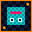
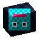

# Pribambase 2.5 — руководство пользователя

Pribambase связывает один Blender-ассет с исходной покадровой текстурой Aseprite. Художник
рисует в Aseprite и видит результат на модели, а Blender отправляет обратно безопасный render
guide для каждого кадра.




## Главная идея

У каждой части ассета есть свой источник истины:

| Данные | Где редактируются |
|---|---|
| Геометрия, деформации и покадровая анимация | Blender |
| Свет и World | Blender |
| Base Color, AO, Roughness, Metallic и Emission | Aseprite |
| Упакованная ORME-карта | Автоматически собирается extension |
| World Normal | Художник рисует в Aseprite обычными инструментами |
| Geometry Normal Flat / Smooth | Blender генерирует оба эталона для каждого кадра; в Aseprite они заблокированы |
| Render guide | Генерируется Blender |
| Связь исходников и параметры проекции | `*.pribambase.json` |

Плагин не создаёт отдельную UV-развёртку для каждого кадра. Все модели используют одну
зафиксированную world-space проекцию и один общий canvas на всю анимацию.

## Установка

### Blender add-on

1. Откройте **Edit → Preferences → Add-ons**.
2. Установите архив Blender add-on и включите его.
3. В 3D Viewport откройте `N → Tool → Pribambase`.

При разработке из этого репозитория используйте PyCharm-конфигурацию
**Blender - Run add-on**. Настройка среды описана в [DEVELOPMENT.md](../DEVELOPMENT.md).

### Aseprite extension

Соберите и установите dev-версию:

```powershell
.\aseprite.ps1 install
```

Либо соберите пакет командой `.\aseprite.ps1 build` и установите
`dist/pribambase.aseprite-extension` через Aseprite. После перезапуска в меню **File** появится
команда **Pribambase: Start Sync**.

Версии Blender add-on и Aseprite extension должны совпадать.

## Быстрый старт на сэмпле

```powershell
.\sample.ps1 run
```

После запуска:

1. В Blender откройте `N → Tool → Pribambase` и нажмите **Start Sync**.
2. В Aseprite выберите **File → Pribambase: Start Sync**.
3. Дождитесь статуса `Sync active`.
4. Откройте **File → Pribambase: Material Channels**, выберите канал и измените пиксели — материал куба обновится.
5. Измените геометрию или свет в Blender — в Aseprite обновится reference-слой
   `Pribambase Render`.
6. В Aseprite откройте **File → Pribambase: Normal Picker**, нажмите **Paint Normals**,
   выберите направление на шаре и рисуйте обычным Pencil. Сравнивайте пиксели с Flat или Smooth.

Если Blender перезапускается или соединение временно пропадает, останавливать Sync в Aseprite не
нужно: окно остаётся активным и каждые две секунды создаёт новое соединение. Кнопка **Reconnect Now**
запускает попытку немедленно; только **Stop** полностью прекращает автоматические повторы.

Сэмпл специально не содержит UV-layer: текстура приходит на объект через глобальную проекцию.

## Глобальная проекция

Профиль `global_iso_v1` одинаков во всех Blender-файлах:

- `20` пикселей на одну Blender unit;
- горизонталь текстуры совпадает с глобальной осью X;
- вертикаль текстуры вычисляется из глобальных Y/Z под фиксированным углом 30°;
- глобальная точка `(0, 0, 0)` является постоянной опорной точкой ассета;
- положение обычной камеры сцены не влияет ни на материал, ни на guide.

Практически это означает: ставьте точку касания модели с землёй в мировой ноль. Один и тот же
пиксель текстуры будет соответствовать одному и тому же месту глобальной проекции на каждом кадре.

### Общий canvas анимации

Кнопка **Recalculate Canvas** просматривает каждый кадр от `Frame Start` до `Frame End`, вычисляет
проекцию всех вершин в **Projected Collection** и берёт объединение максимальных bounds. В canvas
также всегда входят мировой ноль и заданный **Canvas Padding**.

Canvas один для всех кадров. Он не меняет размер и offset при переходе между кадрами, поэтому
рисунок в Aseprite не прыгает относительно модели.

Если более поздняя деформация выходит за старые bounds, включённый **Auto-grow** расширяет canvas:

- Blender сдвигает существующие пиксели без фильтрации;
- Aseprite добавляет прозрачное место с нужных сторон;
- все кадры и слои сохраняют положение относительно мировой нулевой точки;
- автоматического уменьшения и обрезки не происходит.

Расширение canvas в Aseprite попадает в undo history, но `.aseprite` не сохраняется автоматически.

### Камера

Guide всегда рендерится временной канонической камерой. После рендера Pribambase возвращает
пользовательскую камеру, её transform и render settings в исходное состояние. Для guide временно
используется минимальный pixel filter: Blender не создаёт полупрозрачные сглаженные края, и каждому
выходному пикселю соответствует ровно один пиксель canvas. Число render samples не меняется, поэтому
мягкие тени, AO и освещение сохраняют заданное в сцене качество.

**Restore Camera** намеренно ставит активную камеру в канонический ракурс и выставляет точное
разрешение общего canvas. Это команда для проверки кадрирования; проекция материала от камеры не
зависит. Художник может свободно двигать тестовые камеры и проверять модель при другом освещении.

**View Camera** не меняет transform или настройки камеры: кнопка только переводит текущий 3D
Viewport в вид через активную render camera, как `Numpad 0`. Обычно сначала используют
**Restore Camera**, а затем **View Camera**, чтобы сразу увидеть точное кадрирование guide.

## Настройка нового Blender-ассета

1. Сохраните `.blend`.
2. Поместите все проецируемые mesh-объекты в отдельную коллекцию, например `Character`.
3. Создайте или загрузите в Blender изображение с текущим размером Aseprite sprite. PNG-копия
   подходит как стартовый fallback.
4. В **Source Pair** задайте **Asset** и путь **Aseprite**.
5. В **Global Projection** выберите **Projected Collection** и **Paint Texture**.
6. Нажмите **Recalculate Canvas**.
7. Нажмите **Create / Repair Material**.
8. При необходимости нажмите **Restore Camera**.
9. Нажмите **Save Pair**, затем **Start Sync**.

**Create / Repair Material** создаёт один материал `PB_<Asset>_Projected`, назначает его всем
mesh-объектам выбранной коллекции и подключает Paint Texture и Material ORME с фильтрацией
`Closest`. Существующие UV-развёртки не используются.

## Материал между проектами

Каждый source pair имеет локальную оболочку материала, потому что изображение и размеры canvas у
ассетов разные. Внутри неё используется одинаковая версионированная группа
`PB_MasterShader_v4`, которую add-on создаёт из одного определения во всех `.blend`.

Master-группа принимает Base Color, Ambient Occlusion, Roughness, Metallic, Emission Mask и
Emission Strength. Opacity намеренно не входит в контракт. Scalar-каналы хранятся в одном
`PB_<Asset>_ORME` image: `R=AO`, `G=Roughness`, `B=Metallic`, `A=Emission`. В Blender карта имеет
color space **Non-Color** и автоматически раскладывается по входам master-группы.

Base Color, Roughness и Metallic поступают в Principled BSDF напрямую. AO не умножается на
Base Color: в основном EEVEE-preview сначала рассчитывается PBR-освещение, после чего AO
ослабляет только освещённую составляющую пропорционально её яркости. Поэтому AO сильнее заметен
на участках с окружающим светом и почти не добавляет темноты в уже тёмных местах. Для металлов
учитывается Roughness: гладкие отражения сохраняются, а матовые сильнее получают occlusion.
Emission не зависит от AO и складывается после него как
`Base Color × Emission Mask × Emission Strength`.

Blender 5.2 не предоставляет material AO-вход для metallic Principled BSDF. Поэтому Cycles-ветка
использует чистый Principled без нарисованного AO и получает естественное затенение от геометрии/GI.
При экспорте в игровой PBR-материал `ORME.R` должен подключаться как отдельная occlusion texture,
а не запекаться в Base Color.

World Normal является отдельной RGB-картой в глобальных координатах, а не частью ORME. Вектор
`(-1…1)` кодируется как RGB `(0…1)`: красный — глобальная X, зелёный — глобальная Y, синий —
глобальная Z. Источник истины — paint-слои World Normal в `.aseprite`. Карта подключается через
Blender **Normal Map / World Space**, её применение отключается галочкой **Apply World Normal**.
RGB передаётся как Non-Color data без гамма-коррекции.

Live-link внешней material-library пока нет. Версионированная master-группа — основа для такого
подключения без изменения source pair и глобальной проекции.

## Source pair и манифест

Рекомендуемая структура:

```text
goblin/
├── goblin.blend
├── goblin_texture.aseprite
└── goblin.pribambase.json
```

Манифест версии 3 хранит:

- относительные пути `.blend` и `.aseprite`;
- FPS и диапазон кадров;
- настройки live updates;
- профиль проекции и pixels-per-unit;
- имена коллекции, изображения и материала;
- bounds, размер canvas и позицию мирового нуля в пикселях.
- параметры World Normal: владелец Aseprite, world-space, эталоны Flat/Smooth и применение normal map.

**Save Pair** пишет манифест рядом с `.blend`. **Load Pair** восстанавливает настройки по именам
databлоков. Храните все три файла вместе в Git; для `.blend` и `.aseprite` обычно удобен Git LFS.

## Работа в Aseprite

Панель **Pribambase Channels** автоматически открывается вместе с **Start Sync** и не блокирует
рисование. Её можно переместить рядом с настройками кисти; позиция, активная вкладка и
последний канал запоминаются. Если панель закрыта, верните её через
**File → Pribambase: Material Channels**.

Для старого sprite один раз откройте вкладку **Actions** и нажмите **Initialize / Migrate**.
Extension создаст типизированную структуру и безопасно перенесёт существующие paint-слои в
**Base Color**:

```text
Pribambase
├── Base Color
├── Material Channels
│   ├── Ambient Occlusion
│   ├── Roughness
│   ├── Metallic
│   └── Emission
```

Служебные `Pribambase Render` и `Pribambase Geometry Normal (Flat)` и `Pribambase Geometry Normal (Smooth)` находятся отдельно как заблокированные
reference-слои. Они принадлежат Blender и не входят в структуру редактируемых каналов.

Выберите канал в поле **Channel**. Для AO, Roughness, Metallic и Emission редактор:

- показывает одно grayscale-значение `0…255` и его нормализованный эквивалент `0…1`;
- предлагает понятные presets, например Non-metal/Metal и Polished/Matte/Rough;
- переключает видимость так, чтобы на canvas был только редактируемый канал;
- оставляет Base Color видимым под каналом и показывает канал полупрозрачным overlay;
- выбирает отдельный Paint layer; кнопка **Add Paint Layer** создаёт ещё один;
- после каждого изменения автоматически собирает ORME и отправляет её в Blender.

Панель разделена на четыре компактные вкладки:

- **Paint** — Brush Value, presets и Add Paint Layer;
- **View** — видимость и opacity Base Color, отправка каналов и overlay;
- **Generated** — видимость Render Guide, готовность Flat/Smooth, статус текущего кадра и запрос rebuild;
- **Actions** — инициализация/миграция, принудительный refresh и просмотр packed ORME.

При инициализации первый **Paint** cel каждого канала один раз целиком заполняется значением по
умолчанию: AO `255`, Roughness `128`, Metallic `0`, Emission `0`. Отдельных Default layers нет,
а основная карта канала не зависит от прозрачности. При добавлении кадров extension создаёт для
них такой же заполненный cel; при увеличении canvas заполняет дефолтом новые области.

По умолчанию служебные channel-layers имеют **Overlay Opacity 38%**, поэтому форма и цвет основной текстуры
остаются видны во время рисования. Настройка регулируется в Channel Editor и хранится отдельно для
каждого канала. Это только preview-настройка Aseprite: она не ослабляет значения, которые попадают
в ORME. Для значений рисуйте нужным grayscale-цветом; layer opacity у channel-layers
зарезервирован под preview. Дополнительные Paint layers остаются необязательными overlay-слоями,
но под ними всегда находится непрозрачный основной Paint.

Render Guide всегда перемещается в самый низ стека, чтобы все paint-слои отображались поверх него.
**Base Opacity** временно делает Base Color полупрозрачным для рисования по guide. Это preview-настройка:
в Blender продолжает отправляться исходная непрозрачность paint-слоёв. **Reset Base Opacity** возвращает
их отображение к исходным значениям.

Галочки **Send to Blender** независимо управляют Base Color, AO, Roughness, Metallic и Emission.
Они не скрывают и не изменяют paint-слои: выключенный канал только заменяется дефолтом в сообщении
для Blender. Используются серый Base Color `204`, AO `255`, Roughness `128`, Metallic `0` и
Emission `0`. Изменение галочки сразу обновляет Blender, поэтому результат можно проверять по
Render Guide прямо в Aseprite.

**Show Packed ORME** открывает временный диагностический sprite. Его не редактируют и не сохраняют
как источник. **Refresh Blender** принудительно пересобирает текущий кадр, если автоматическое
обновление не было видно.

Extension распознаёт служебные группы по внутренним properties, поэтому художник может их
переименовывать. Не копируйте отдельные группы между независимыми `.aseprite`: для нового файла
используйте **Initialize Channels**.

Blender guide создаётся как заблокированный reference-слой вне Base Color и не входит в composite,
который extension отправляет обратно. Поэтому guide и скрытые material-каналы не могут случайно
«запечься» в Base Color.

Оба Geometry Normal устроены так же: это заблокированные reference-слои с отдельными cel для каждого кадра. World Normal художника — отдельная редактируемая группа.
Его можно показывать на вкладке **Generated**, но нельзя рисовать или стирать в Aseprite. Повторный
bake заменяет байты существующего cel без добавления обычного действия рисования в undo history.
**Request Rebuild** просит Blender пересобрать текущий кадр; sync должен быть активен.

Если обычный слой уже называется `Pribambase Render`, extension создаст reference-слой с
суффиксом `(Guide)` и не затронет пользовательские пиксели.

## Покадровая анимация

Кадры сопоставляются один к одному:

```text
Blender frame 1  ↔  Aseprite frame 1
Blender frame 2  ↔  Aseprite frame 2
```

При включённом **Follow Animation Frame** приложения повторяют переключение кадра. Если Blender
отправляет guide на ещё не существующий кадр Aseprite, extension сначала добавляет пустые кадры,
затем создаёт reference-cel. Paint-cels не удаляются.

Если у Base Color или material-канала нет собственного cel на текущем кадре, при отправке в Blender
используется последний предыдущий cel. Это работает как hold exposure: создание новых guide-кадров
не превращает материал модели в чёрный. Чтобы намеренно очистить канал на кадре, создайте на нём
собственный прозрачный cel.

Для 12 FPS без интерполяции выберите ключи Blender и задайте
**Key → Interpolation Mode → Constant**. Допустимы rig, shape keys, lattice, modifiers и ручная
покадровая деформация — canvas считается по итоговой evaluated mesh каждого кадра.

После изменения диапазона кадров или крупной деформации нажмите **Recalculate Canvas** перед
пакетным обновлением guides.

## Рисование World Normal в Aseprite

Blender автоматически отправляет два эталона в разрешении общего canvas:

- **Flat** — мировые нормали полигонов, независимо от smooth shading модели;
- **Smooth** — сглаженные нормали поверхности. Исходные настройки сглаживания mesh не меняются.

Оба варианта запекаются и передаются вместе. В Blender нет переключателя варианта.
При изменении геометрии эталоны устаревают и обновляются вместе с guide; при смене кадра
передаются эталоны соответствующего кадра. **Generate + Send Both References** и **Rebuild Both References**
позволяют явно обновить их. Ручные мазки при этом сохраняются.

### Пикер направления

1. В Aseprite откройте **File → Pribambase: Normal Picker** либо выберите **World Normal** в
   Material Channels и нажмите **Open Normal Picker / Compare Pixel**.
2. В группе **Canvas** нажмите **Paint Normals**. Активируется обычный paint-слой World Normal.
3. Выберите **Step**: Free, 90°, 45°, 30°, 22.5°, 15° или 7.5°.
4. Выберите направление на одном из двух шаров и рисуйте обычными Pencil/Line/Fill. Пикер задаёт
   foreground RGB; мазки, ластик и Undo остаются обычными действиями Aseprite.

Оба шара показывают одну полусферу в проекции камеры рендера: X вправо, вверх — экранная вертикаль,
центр — направление к камере. Это фиксированная проекция проекта с возвышением 30°, а не текущий
ракурс Blender viewport. Обратная полусфера недоступна; контур шара — доступные касательные направления.
Поэтому −Y и +Z доступны, ±X находятся на контуре, +Y и −Z отключены.

Сетки строятся активными поворотами вокруг неподвижных **мировых** осей из исходной нормали −Y:
левый шар — **Z → X**, правый — **X → Z**. Step задаёт шаг параметров поворота; расстояние между
всеми соседними точками на сфере не обязано быть одинаковым. Общие точные оси и диагонали остаются
доступными при любом шаге. Направление точно на камеру доступно в Free или при попадании в сетку:
например, при шаге 30°, но не 45°. Смена Step не округляет уже выбранную кисть.

Клик привязывает направление к сетке того шара, по которому рисуют. Звёздочка в заголовке отмечает
сетку для численного ввода. Кисть общая: на обоих шарах она находится в одной позиции, даже если
на другом шаре эта позиция лежит между узлами. В Free обе поверхности выбирают одинаковые направления.

Цветные линии показывают **векторы нормалей**, лежащие в мировых плоскостях: XY — Z=0 (синий),
XZ — Y=0 (зелёный), YZ — X=0 (красный). Белые точки отмечают оси и основные диагонали, в том числе
пространственные. Наведение раскрывает XYZ, точное имя ориентира и принадлежность плоскости.
**Plane: Any / XY / XZ / YZ** ограничивает выбор с шара и численный ввод соответствующей плоскостью.
Кнопки осей и взятия референса задают точное направление независимо от этой привязки.

### Кнопки и группы окна

| Группа | Элемент | Действие |
|---|---|---|
| Direction | **Step** | Шаг сеток; Free отключает угловую привязку |
| Direction | **Plane** | Ограничение сетки и выбора одной координатной плоскостью |
| Direction | **±X / ±Y / ±Z** | Точное осевое направление; скрытые от камеры оси отключены |
| Brush direction | **Brush / RGB** | Фактический цвет кисти; образец служит индикатором |
| Brush direction | **Options** | Раскрывает XYZ кисти, численный ввод, разметку и группу Geometry |
| Brush direction → Options | **Screen angle** | Направление на экране: 0° вправо, 90° вверх |
| Brush direction → Options | **From camera** | Отклонение от камеры: 0° в центре, 90° на контуре; привязка использует сетку со звёздочкой |
| Brush direction → Options | **XY / XZ / YZ**, **Diagonals** | Показывают или скрывают соответствующую разметку |
| Inspect pixel | **Inspect Pixel** | Выбор и фиксация пикселя без рисования; Esc отменяет выбор |
| Inspect pixel | **Follow cursor** | Непрерывное исследование пикселя под курсором |
| Inspect pixel | **Use Painted / Use Flat / Use Smooth** | Точный RGB соответствующего пикселя в кисть без округления к сетке |
| Canvas | **Paint Normals** | Возвращает редактируемую карту и активирует paint-слой |
| Canvas | **View Flat / View Smooth** | Просмотр одного из эталонов без изменения рисунка или отправляемой карты |
| Geometry, при включённом Options | **Rebuild Both References** | Просит Blender обновить оба эталона текущего кадра; нужен Sync в обоих приложениях |

Основные действия помещаются в компактном окне. При раскрытых Options или на маленьком экране
доступна прокрутка; шары сохраняют размер. Заголовок Canvas показывает текущий режим просмотра.

### Инспектор и сравнение

Инспектор всегда сравнивает **оба** эталона одного пикселя и кадра. Переключателя Reference нет.
На каждом шаре одновременно отображаются:

- белый крест — кисть;
- голубой круг — итоговая нарисованная нормаль, включая Flat под прозрачными мазками;
- янтарный ромб — Flat;
- фиолетовый треугольник — Smooth.

Формы и размеры различаются даже при совпадении направлений. Ниже показаны три XYZ и две угловые
разницы: **Painted vs Flat** и **Painted vs Smooth**. Просмотр Flat/Smooth на холсте не меняет эти данные.
Прозрачные пиксели не имеют направления и показываются как **No covered pixel**.

Недопустимый пиксель в уже существующем рисунке или референсе отмечается **HIDDEN** и маркером
с красным крестиком на контуре; кнопка взятия в кисть отключена. Его направление и угловые разницы
сохраняются для диагностики. Контурный маркер в этом случае является предупреждением, а не точной
позицией направления. Пикер не исправляет рисунок автоматически.

Пока пикер открыт и активен слой World Normal, выбор цвета из обратной полусферы обычной палитрой
или пипеткой Aseprite блокируется с сохранением предыдущей допустимой кисти. Цвета других каналов
не ограничиваются. Вставка готовых изображений и работа при закрытом пикере остаются обычными
действиями Aseprite; такие пиксели можно проверить инспектором.

Карта художника компонуется из прозрачных paint-слоёв поверх Flat. Пока пиксель не закрашен,
он сохраняет полигональную нормаль. Smooth служит независимым эталоном для художника;
его выбор в инспекторе не меняет основу карты, мазки или материал модели.
Normal channel имеет отдельный **Send to Blender**: при отключении посылается Flat без мазков,
при включении — сохранённая карта художника. Карты разных кадров хранятся отдельно.

### Миграция старых исходников

Для сохранённой пары версии 2.4 выполните:

```bash
./dev.sh pair migrate path/to/asset.pribambase.json
```

В Windows: `.venv\Scripts\python.exe tools\pair_dev.py migrate path/to/asset.pribambase.json`.
Перед этим сохраните и закройте исходники, чтобы старое окно приложения не перезаписало результат.
Мигратор делает резервные копии `.blend`, `.aseprite` и манифеста в `build/migrations/`,
обновляет manifest до schema 5 и Aseprite channels до schema 7, удаляет старые Blender-правки
нормалей и генерирует оба эталона для всех кадров. Остальные рисунки, геометрия и анимация
сохраняются. При ошибке оригиналы восстанавливаются. Повторная миграция сохраняет новые мазки.

При обычном открытии Blender очищает старый формат brush-данных в памяти; Aseprite обновляет
структуру при инициализации или подключении. Для записи сразу всей пары используйте мигратор.

## Команды Blender

### Global Projection

| Команда или настройка | Назначение |
|---|---|
| **Projected Collection** | Mesh-объекты, участвующие в bounds и общем материале |
| **Paint Texture** | Blender Image, обновляемый из Aseprite |
| **Material ORME** | Сгенерированная карта AO/Roughness/Metallic/Emission |
| **Emission Strength** | Яркость свечения там, где Emission больше нуля |
| **Canvas Padding** | Прозрачный запас вокруг максимальных bounds |
| **Auto-grow** | Расширять общий canvas при росте анимации |
| **Recalculate Canvas** | Просканировать весь диапазон кадров |
| **Restore Camera** | Вернуть канонический ракурс и разрешение |
| **View Camera** | Перевести текущий 3D Viewport в вид через активную render camera |
| **Create / Repair Material** | Пересоздать и назначить world-projected материал |

### World Normal

| Команда или настройка | Назначение |
|---|---|
| **Generate + Send Both References** | Сгенерировать Flat и Smooth текущего кадра и передать оба в Aseprite |
| **Apply World Normal** | Применять карту художника в shader и render guide |

### Live Updates

| Команда или настройка | Назначение |
|---|---|
| **Auto-render Current Frame** | Обновлять guide после изменения mesh, света или World |
| **Auto-render Delay** | Задержка перед автоматическим рендером |
| **Render Dirty Frames on Save** | Обновить изменённые кадры при сохранении `.blend` |
| **Follow Animation Frame** | Синхронизировать активный кадр |
| **Projection Layer** | Имя reference-слоя |
| **Update Guide** | Немедленно отрендерить текущий кадр |
| **Render Dirty Frames** | Последовательно отрендерить изменённые кадры |
| **Open Aseprite** | Открыть или сфокусировать парный sprite |
| **Pause** | Остановить обмен |

## Работа двух специалистов

Моделлер владеет основным `.blend`, меняет геометрию, деформации и эталонный свет, пересчитывает
canvas и публикует guides. Художник владеет `.aseprite`, рисует на paint-слоях и проверяет
результат на модели.

Для тестов в другом освещении полезен отдельный preview `.blend`, который подключает модель через
Blender Library Link или Library Override и использует тот же `.aseprite`. Так художник может
менять локальные лампы и камеры, не создавая конфликтов в основном бинарном файле.

## Работа по сети

По умолчанию Blender принимает соединения только с `localhost`. Для доверенной LAN:

1. Отключите **Same computer only** до запуска sync.
2. В Aseprite **Sync: Settings** укажите IP компьютера с Blender.
3. Проверьте одинаковый порт, по умолчанию `34613`.
4. Разрешите Blender во входящем firewall.

Протокол не содержит аутентификации и шифрования. Не публикуйте порт напрямую в интернет;
используйте доверенную сеть или VPN.

## Безопасность данных

- paint-слои и paint-cels не удаляются;
- guide использует только reference-layer;
- Flat и Smooth используют read-only reference-слои, а карта художника хранится в `.aseprite`;
- canvas автоматически только растёт и никогда не обрезается;
- входящая текстура не запускает бесконечный цикл обратных рендеров;
- временные PNG удаляются;
- пользовательская камера и render settings восстанавливаются после guide;
- `.aseprite` не сохраняется автоматически;
- **Save Pair** пишет JSON, но не заменяет сохранение `.blend`.

## Решение проблем

### Aseprite потерял соединение с Blender

- Оставьте окно Sync открытым: статус `Disconnected · retrying automatically...` означает, что
  повторные подключения уже выполняются каждые две секунды.
- После запуска Blender соединение восстановится без Stop/Start Sync.
- Для немедленной попытки нажмите **Reconnect Now** в основном окне или меню Actions.
- **Stop** используйте только когда хотите действительно завершить сессию синхронизации.

### Текстура не видна на модели

- Проверьте **Paint Texture**.
- Нажмите **Create / Repair Material**.
- Проверьте, что объект находится в **Projected Collection**.
- Используйте Material Preview или Rendered View.
- Проверьте статус `Sync active` и Aseprite **Size Limit**.

### Material-канал не меняется в Blender

- Откройте **Pribambase: Material Channels** и убедитесь, что выбран нужный канал.
- Рисуйте оттенками серого на Paint layer, созданном Channel Editor.
- Нажмите **Refresh Blender**.
- В Blender проверьте **Material ORME** и нажмите **Create / Repair Material**.
- Для Emission проверьте ненулевой **Emission Strength** и используйте Rendered/Material Preview.

### World Normal не видна или не обновляется

- Запустите Sync в обоих приложениях и проверьте, что версии add-on и extension совпадают.
- В Blender нажмите **Recalculate Canvas**, затем **Generate + Send Both References**.
- В Aseprite откройте **Normal Picker → Paint Normals** и убедитесь, что рисуете на Paint.
- В Blender включите **Apply World Normal**, в Aseprite — **Send to Blender → World Normal**.
- Оба эталона сравниваются одновременно. **View Flat / View Smooth** меняют только просмотр.
- Для ручного обновления откройте **Options → Geometry → Rebuild Both References**.
- Для старой пары сначала выполните миграцию.

### Проекция смещена или обрезана

- Убедитесь, что опорная точка ассета находится около глобального `(0, 0, 0)`.
- Нажмите **Recalculate Canvas** после изменения геометрии или диапазона кадров.
- Нажмите **Restore Camera** для визуальной проверки.
- Не редактируйте значения canvas вручную в манифесте.

### Guide не появляется

- Убедитесь, что парный `.aseprite` открыт.
- Нажмите **Update Guide** и прочитайте сообщение Blender.
- Ищите reference-слой `Pribambase Render (Guide)`, если имя занято paint-слоем.
- Проверьте, что **Projected Collection** содержит renderable mesh.

### Guide выглядит размытым

- Обновите Blender add-on и Aseprite extension, затем снова нажмите **Update Guide**.
- Для guide Pribambase сам отключает render-side сглаживание; менять общие настройки рендера не нужно.
- Если размывается paint-текстура на модели, нажмите **Create / Repair Material**: её Image Texture
  должна использовать `Closest`.

### Area Light даёт пятнистый свет или шумные мягкие тени

В EEVEE большой Area Light рассчитывает мягкие тени случайными выборками. При малом числе лучей
частично перекрытый источник может выглядеть как пятна слабого света, особенно на небольшом
pixel-art guide. Это не шум Base Color или AO.

- Для заполняющего света (**Fill Light**) рекомендуется выключить **Light Properties → Shadow**.
  Подсветка станет ровной, а основные тени продолжит создавать Key Light.
- Если Area Light должен отбрасывать тени, откройте **Render Properties → Sampling → Shadows** и
  установите **Rays = 4** — это максимальное значение в Blender 5.2.
- Если шума всё ещё много, увеличьте **Render → Samples** с `64` до `128` или `256`. Pribambase
  сохраняет заданное в сцене число samples и по-прежнему использует минимальный pixel filter,
  поэтому повышение samples не включает размытие пиксельных границ.
- Уменьшение **Size** у Area Light делает область мягкой тени уже, но одновременно меняет характер
  освещения сцены.

### Canvas в Aseprite увеличился

Это ожидаемо, если любой кадр анимации вышел за старые bounds. Операцию можно отменить в Aseprite,
но следующий sync снова запросит размер, необходимый Blender. Исправьте геометрию или padding,
затем сохраните осознанно. Автоматического уменьшения canvas нет.

### Слишком много рендеров

Увеличьте **Auto-render Delay** или временно выключите **Auto-render Current Frame**. Изменение
обычной камеры само по себе guide не обновляет, потому что глобальная проекция от неё не зависит.

## Пока не реализовано

- автоматический экспорт атласов всех каналов, включая покадровый World Normal;
- bloom и дополнительные channel maps;
- live-link внешней Blender material-library;
- Beauty, Shadow, Mask, Material ID и Line passes;
- автоматическое создание preview `.blend`;
- блокировка бинарных исходников между участниками;
- автоматическое переключение keyframes в Constant Interpolation.
