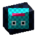

# Pribambase round-trip sample

This example demonstrates both directions of the Pribambase workflow:

1. pixels edited in Aseprite update a material on a Blender object;
2. Blender renders the projected object back into an Aseprite reference layer.




## Open the sample

In PyCharm, run **Sample - Run roundtrip**. The configuration installs the current development
extension, opens `roundtrip_texture.aseprite`, and opens `pribambase_roundtrip.blend` with the current
Blender add-on source.

The same action is available from the terminal:

```powershell
.\sample.ps1 run
```

## Aseprite to Blender

1. In Blender, open the sidebar with `N`, select **Tool > Pribambase**, and press **Start Sync**.
2. In Aseprite, select **File > Pribambase: Start Sync** and wait for `Sync active`.
3. The compact **Pribambase Channels** panel opens automatically. Choose Base Color, AO,
   Roughness, Metallic, or Emission on its **Paint** tab.
4. Paint on the selected source layer. Scalar channels use grayscale values and presets.
   Base Color remains visible below the channel's default 38% preview overlay; adjust
   **Overlay Opacity** without changing the values packed into ORME.
5. Look at `AsepriteTexturedCube` in Blender using Material Preview or Rendered shading. Changes
   are transferred automatically after each Aseprite edit.

The extension sends Base Color separately and packs the scalar channels into a generated ORME image:
R = Ambient Occlusion, G = Roughness, B = Metallic, A = Emission. Blender unpacks it automatically;
the artist never has to paint directly into RGBA components.

The Blender image is named `RoundtripTexture`. It stores a portable source link to
`//roundtrip_texture.aseprite`, uses nearest-neighbor sampling, and is packed into the `.blend` so
the scene has a visible fallback before the first sync.

## Blender to Aseprite

1. Keep the connection active.
2. Change the cube or lighting. After the configured idle delay, Blender automatically
   updates the current frame's guide in Aseprite.
3. Use **Update Guide** in the 3D View panel for an immediate refresh.
4. Use **Render Dirty Frames** to update every changed animation frame.

The sample pair is configured for 12 FPS and frames 1–12. When Blender sends a guide to a frame
that does not exist yet, the Aseprite extension appends empty frames before creating the reference cel;
existing painted cels are kept intact.

Blender renders the canonical orthographic 64×64 projection with render-side anti-aliasing disabled
and sends the pixel-perfect result to the paired Aseprite document as a per-frame reference layer named
`Pribambase Render`. The reference cel is replaced on subsequent sends and does not overwrite the
painted texture layer.

The cube intentionally has no UV layer. `PB_Roundtrip_Cube_Projected` samples the texture from
fixed world coordinates, while **Restore Camera** only restores the matching inspection view.
The shared animation canvas is stored in the pair manifest and applies to all 12 frames.

## Blender direct World Normal editing

1. In Blender open **Pribambase → World Normal Edit** on frame 1 and press **Initialize from Geometry**.
2. Choose a target world direction, Radius/Strength, and press **Paint Normals**.
3. Paint on the cube with LMB and finish with `Enter`; use `Q/E` or `1–5` to switch tools, Ctrl+wheel
   for the active tool radius/size, Alt+wheel for strength, MMB/wheel to pan/zoom the camera view,
   and Tab/Shift+Tab to cycle previews. Shift+1–4 directly select Edited/Final/Geometry/Material.
   Ctrl+Z/Ctrl+Y undo and redo individual strokes; Enter, Esc, and RMB all
   finish the mode while saving the current result.
4. Keep **Apply Generated World Normal** enabled to see the result in the material and guide.
5. In Aseprite open the **Generated** tab and enable **World Normal → Show**.

The sample canvas is `64×64`, so Blender stores a `128×128` editable World Normal source and derives
a `64×64` RGB output by averaging and renormalizing each 2×2 block. The source remains editable only
in the `.blend`; the output arrives in Aseprite as a locked per-frame reference layer. Each animation
frame is initialized separately so deformed geometry keeps its own sharp surface transitions.

Use **Material / Edited / Geometry / Final** to compare the regular shader, editable encoded RGB
vectors, the immutable geometry bake, and the final 1× map used by the material. The eyedropper and
`Alt+LMB` sample the visible Edited, Geometry, or Final map. **Bulge** and **Dent** create projected
bumps and cavities directly in the
normal vectors; Paint, Smooth, Bulge, and Dent remember separate Ctrl+wheel-adjustable radii. **Set Pixel**
writes an exact normalized direction with its own Ctrl+wheel-adjustable square Size. Its unit is either a
final Output Pixel (expanded to 2×2 edit samples) or an individual Edit Sample.
Decreasing below Output Size 1 automatically selects the smallest Edit Sample 1×1 step; increasing
crosses back through Output Size 1 before Size 2.

Press `N` while painting, or use the gizmo button next to the eyedropper, to open the viewport Normal
Ball. It shows global XYZ axes plus selected/current arrows on the model. Continuous mode accepts any
camera-facing unit direction. Quantized mode subdivides every 90° great-circle arc between signed
global axes: `1/2 = 45°`, `1/3 = 30°`, `1/4 = 22.5°` by default, through `1/12 = 7.5°`.
Interior directions are generated symmetrically without Euler rotation order. Use `Q` for mode, the
wheel for the division count, and LMB/Enter to accept.

## Rebuild and validate

The generated assets are checked in so the example is ready immediately. To recreate them:

```powershell
.\sample.ps1 build
.\sample.ps1 test
```

`build` overwrites the sample `.blend`, `.png`, `.aseprite`, and `.pribambase.json` files. `test`
opens the generated scene in background Blender, validates the source pair and material link,
performs a real render, and checks that the result contains visible pixels.
